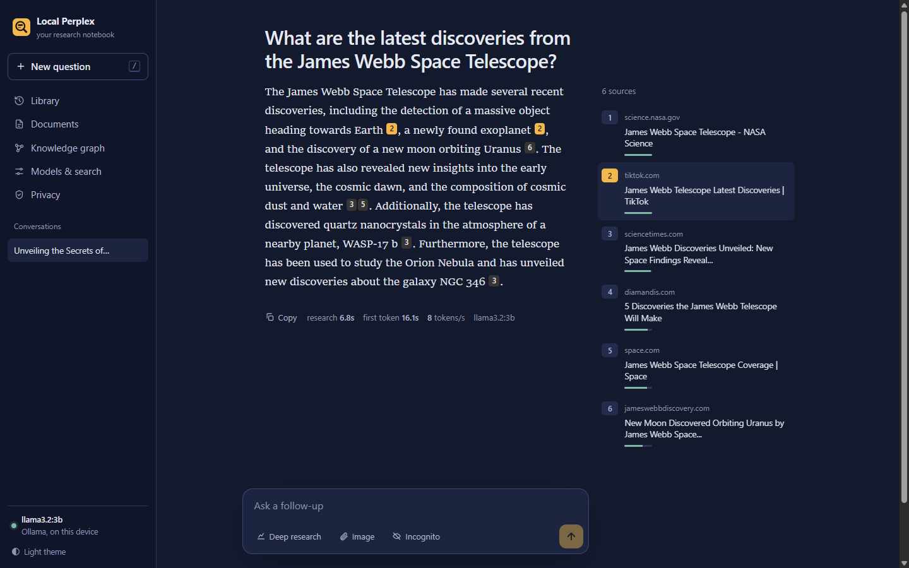
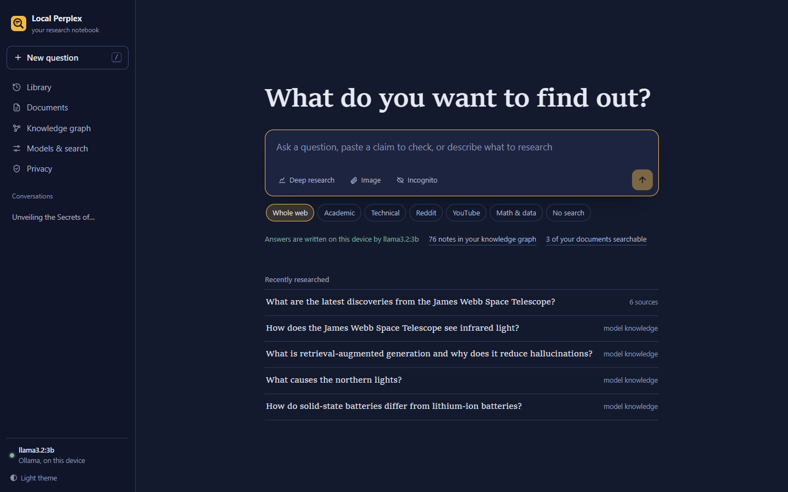
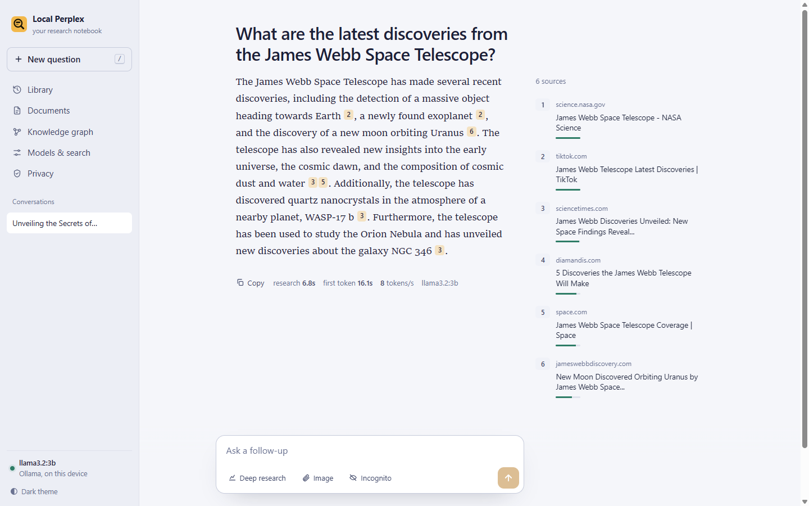
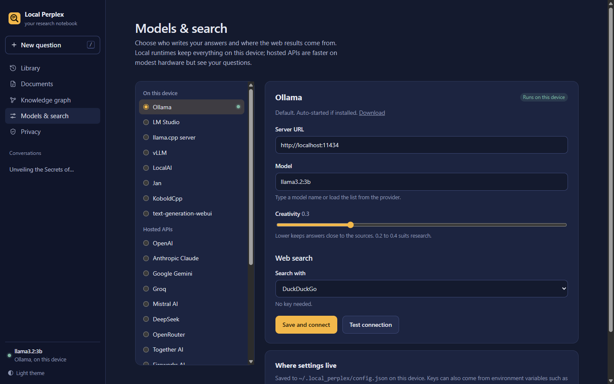
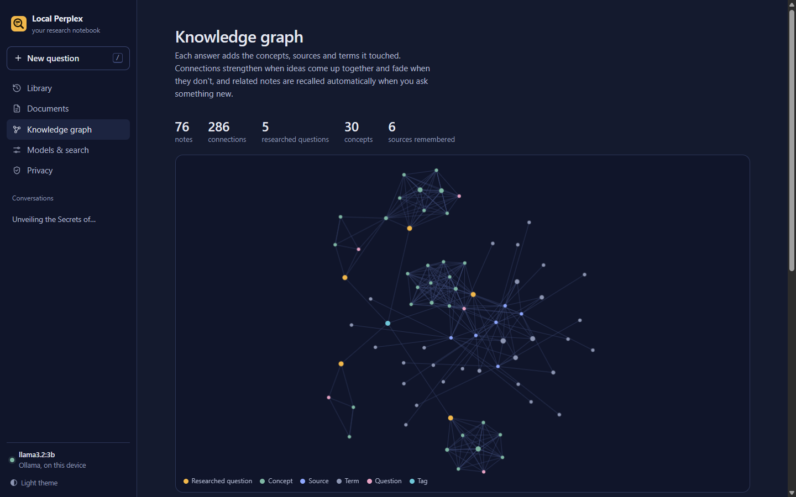
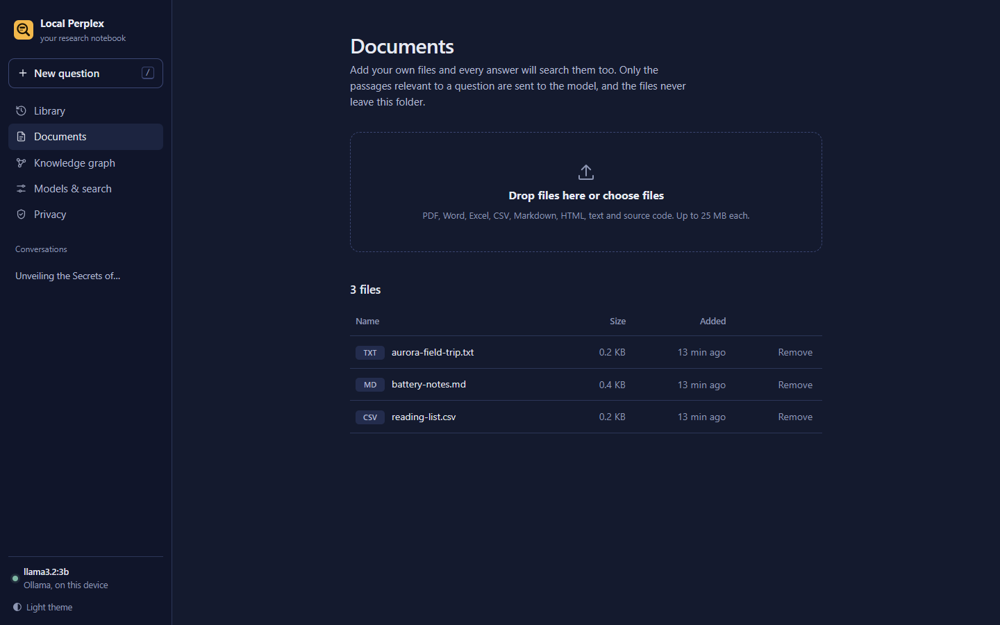
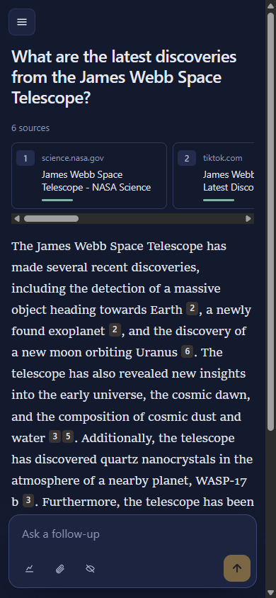
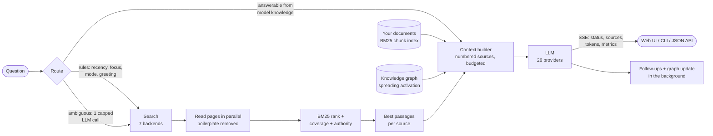

<div align="center">


# Local Perplex

**A private, local-first AI research assistant.**
Ask a question; it searches the web and your own documents, reads the pages, ranks the evidence and writes a cited answer, all on your machine if you want it to be.




</div>

## Highlights

| | |
|---|---|
| **17× better retrieval** | The BM25 ranker scores **0.654 nDCG@10** on the BEIR SciFact benchmark, up from 0.038 for the original scorer, and within 2% of the published Anserini BM25 baseline (0.665). [Benchmarks](#benchmarks) |
| **Instant answer page** | The answer page renders in **about 200 ms**, then streams progress, sources and tokens over SSE. v1 blocked the page on search plus 3 sequential LLM calls. |
| **26 LLM providers** | 8 local runtimes (Ollama, LM Studio, llama.cpp, vLLM, …) and 17 hosted APIs (OpenAI, Claude, Gemini, Groq, DeepSeek, OpenRouter, …), all behind 3 small adapters. Switch from the Settings page or with one flag. |
| **Cited, grounded answers** | Sources are numbered the same way in the prompt and in the UI, and the model is told to cite them inline. 5 of 5 benchmark answers from a 3B local model cited their sources. |
| **Your documents, privately** | PDFs, Word, Excel, CSV, Markdown, HTML and code are chunked and BM25-indexed. Only the relevant passages reach the model: **2.4 ms** to search 1,790 chunks (1.1 MB). |
| **Memory that grows** | A SQLite knowledge graph of concepts, sources and past answers with Hebbian strengthening and decay. Recall takes **18 ms** over a 4,238-node graph; writes are **77× faster** than v1. |
| **Private by default** | Runs fully offline-capable on Ollama and DuckDuckGo with no keys. No telemetry, no third-party scripts or fonts, TLS verification on, cross-site request protection, incognito mode. |

## Screenshots

| Ask | Read |
|---|---|
|  |  |
| **Choose any model** | **See what it remembers** |
|  |  |
| **Search your files** | **Works on a phone** |
|  |  |

## How it works



1. **Route.** Cheap rules settle most questions (recency words, chosen focus, research mode, greetings). Only ambiguous questions cost one LLM call, capped at 24 tokens, which also rewrites the search query.
2. **Search and read.** The chosen backend returns hits; pages are fetched in parallel with a 12 s budget, 2 MB cap and TLS verification, and `<nav>`, `<footer>`, scripts and other boilerplate are stripped.
3. **Rank.** BM25 over the candidate set (title counted twice), blended with query-term coverage and a small authority prior for `.edu`, `.gov`, arXiv and Wikipedia. Duplicate URLs are merged.
4. **Retrieve passages.** Instead of the first *N* characters of each page, the most relevant ~600-character passages are selected per source, then your documents and graph memory are added within a context budget sized for the model (6k characters local, 14k hosted).
5. **Synthesize.** The answer streams token by token with inline `[n]` citations that link to the margin notes. Follow-up questions are generated next, and concept extraction for the knowledge graph runs in a background thread.

**Deep research** plans three complementary queries (background, specifics, recent developments), runs them **in parallel**, merges and re-ranks the results, and writes a longer structured report.

## Benchmarks

All numbers come from the scripts in [`benchmarks/`](benchmarks) and are saved as JSON in [`benchmarks/results/`](benchmarks/results). Machine: a laptop with an Intel Core i5-1135G7 (4 cores / 8 threads, 2.4 GHz), 24 GB RAM, **no GPU**, Windows 11, Python 3.12, Ollama 0.40.

### Retrieval quality: BEIR SciFact

5,183 scientific abstracts, 300 expert-written test queries. Standard BEIR metrics.

| Ranker | nDCG@10 | Recall@10 | Recall@100 | MRR@10 | Latency / query |
|---|---:|---:|---:|---:|---:|
| v1 term-frequency scorer | 0.038 | 0.058 | 0.177 | 0.032 | 323 ms |
| **v2 BM25 + stemming** (this repo) | **0.654** | **0.773** | **0.882** | **0.620** | **9.5 ms** |
| *Published Anserini BM25 (reference)* | *0.665* | | | | |

The v1 score saturated at 1.0 for most long documents, so rankings were effectively ties. v2 is a from-scratch Okapi BM25 (k1 = 1.2, b = 0.75, Lucene IDF) with stopwords and a light stemmer, and it lands within 2% of the reference implementation.

```bash
python benchmarks/bench_retrieval.py        # downloads SciFact (2.7 MB) once
```

### Pipeline

| Stage | v1 | v2 |
|---|---:|---:|
| Answer page visible after pressing Enter | after search + 3 LLM calls | **150–220 ms** |
| LLM calls before research starts | 3, sequential, uncapped (**5.0 s** median) | 0–1, capped (**2.6 s** median, 0 s when rules decide) |
| Record one research session in the graph | 1,176 ms | **15 ms** (77× faster, one transaction) |
| Rank a typical result set (12 pages × 3,000 words) | n/a | **23 ms** |
| Pick the best passages from a 20,000-character page | first 2,500 chars, no selection | **2.6 ms**, finds the needle |
| Search the document vault (1,790 chunks, 1.1 MB) | every file pasted into every prompt | **2.4 ms**, top passages only |
| Recall from a 4,238-node, 16,400-edge graph | n/a | **18 ms** |
| Ollama context window | server default (as low as 2,048 tokens, which silently truncates long prompts) | 4,096, set explicitly to fit the budget |

One-shot BM25 over 10,000 random documents (5.9 s) is slower than v1's plain term counts (1.2 s), because it computes IDF and stems every term. Real queries rank about a dozen pages, and the indexed path above is 34× faster per query than v1.

### Live, end to end (llama3.2:3b on CPU)

Five questions through real DuckDuckGo search, page reading and a 3B model running on the laptop CPU above, with web search forced on so every answer is grounded:

| Metric | Median |
|---|---:|
| Research (search + read 6 pages + rank + retrieve) | **5.8 s** |
| Sources used per answer | 6 |
| Answers containing inline citations | **5 / 5** |
| Citations per answer | 4 |
| Generation speed | 7.6 tokens/s |
| Time to first token, including research | 28.6 s |

Time to first token is dominated by the CPU processing the ~5,000-character prompt. With a GPU, or a hosted provider such as Groq or OpenAI, that step takes about a second. The pipeline is identical; only the `--provider` changes.

```bash
python benchmarks/bench_pipeline.py                           # offline micro-benchmarks
python benchmarks/bench_pipeline.py --live --always-search    # real search + your model
python benchmarks/bench_pipeline.py --live --provider groq --model llama-3.3-70b-versatile
```

## Quick start

```bash
git clone https://github.com/N0t-Harshil/Local-Perplex.git
cd Local-Perplex
pip install -e .

ollama pull llama3.2:3b        # or skip this and use any provider below
perplex-gui                    # http://localhost:8000
```

If Ollama is installed but not running, Local Perplex starts it for you.

### Docker

```bash
docker compose up -d
docker compose exec ollama ollama pull llama3.2:3b
# open http://localhost:8000
```

### Use a hosted model instead

```bash
export GROQ_API_KEY=gsk_...
perplex-gui --provider groq --model llama-3.3-70b-versatile
```

Or pick a provider, paste a key and press **Test connection** on the *Models & search* page.

## Providers

| On this device | | Hosted APIs | |
|---|---|---|---|
| Ollama *(default)* | LocalAI | OpenAI | Cerebras |
| LM Studio | Jan | Anthropic Claude | Cohere |
| llama.cpp server | KoboldCpp | Google Gemini | Hugging Face Inference |
| vLLM | text-generation-webui | Groq | NVIDIA NIM |
| | | Mistral AI | SambaNova Cloud |
| | | DeepSeek | DeepInfra |
| | | OpenRouter | Together AI |
| | | xAI Grok | Fireworks AI |
| | | Perplexity Sonar | **Custom** OpenAI-compatible endpoint |

Three adapters cover all 26: native **Ollama**, **OpenAI-compatible** (streaming with usage stats, vision as content parts) and native **Anthropic Messages** (system prompt split out, role merging, SSE deltas). Each tracks time to first token and tokens per second, which the UI shows under every answer.

**Search backends:** DuckDuckGo *(default, no key)*, SearXNG *(self-hosted, most private)*, Brave Search, Tavily, Serper (Google), Wikipedia, arXiv. Academic focus mixes arXiv papers into any backend, and a failing backend falls back to DuckDuckGo.

```bash
perplex --list-providers
```

## Command line

```bash
perplex "What is retrieval-augmented generation?"
perplex --mode pro "Compare solid-state and lithium-ion batteries"     # parallel deep research
perplex -p anthropic -m claude-haiku-5-5 "Summarise the latest JWST findings"
perplex -f Academic --search arxiv "diffusion models for protein design"
perplex --incognito "something you don't want saved"
```

Answers stream as rendered Markdown, followed by a numbered source table and follow-up suggestions.

## JSON API

```bash
curl -s localhost:8000/api/ask -H 'Content-Type: application/json' \
  -d '{"question": "Who won the 2022 FIFA World Cup?"}' | jq '.answer, .sources[0], .metrics'
```

| Endpoint | Purpose |
|---|---|
| `POST /api/ask` | Research a question, return answer, sources and timings as JSON |
| `GET /stream-answer?job=…` | Server-sent events: `status`, `update_sources`, `chunk`, `done` with metrics |
| `GET /api/status` | Provider, model, reachability, graph size |
| `GET /api/providers` · `POST /api/providers/models` | Provider catalogue (keys masked) and model discovery |
| `POST /api/settings` | Switch provider, model, search backend, temperature |
| `GET /api/graph/data` | Nodes and edges for visualisation |
| `GET /healthz` | Liveness probe |

Interactive OpenAPI docs are served at `/docs`.

## Configuration

Settings resolve in this order: CLI flags, then environment variables, then `~/.local_perplex/config.json` (written by the Settings page), then defaults. See [`.env.example`](.env.example) for every variable.

| Variable | Default | |
|---|---|---|
| `LOCAL_PERPLEX_PROVIDER` | `ollama` | Any id from `perplex --list-providers` |
| `LOCAL_PERPLEX_MODEL` | provider default | e.g. `llama3.2:3b`, `gpt-4o-mini` |
| `LOCAL_PERPLEX_SEARCH` | `duckduckgo` | `searxng`, `brave`, `tavily`, `serper`, `wikipedia`, `arxiv` |
| `OPENAI_API_KEY`, `ANTHROPIC_API_KEY`, … | | One per hosted provider |
| `OLLAMA_HOST` | `http://localhost:11434` | |
| `HOST` / `PORT` | `127.0.0.1` / `8000` | Bind address of the web UI |

## Privacy and security

- **Nothing leaves the device** on the default setup except short search queries. The Privacy page states exactly what goes where for the provider you've chosen.
- **API keys** live in `~/.local_perplex/config.json` (user-only permissions where the OS supports them), are never written to the project folder, and are only ever shown as `sk-…a1b2`. Hosted providers' base URLs can't be changed, so a stored key can't be redirected to another server.
- **Cross-site request protection:** state-changing requests from another origin are rejected, so a malicious tab can't swap your provider URL or delete data. The server binds to `127.0.0.1` by default and sends `X-Frame-Options: DENY` and `nosniff`.
- **Safe rendering:** the built-in Markdown renderer escapes HTML before formatting and only links `http(s)` URLs. There are no CDN scripts, web fonts or favicon lookups (which would leak every source domain to a third party).
- **Uploads** are limited to known document types and 25 MB, with path components stripped. Page fetches verify TLS and stop at 2 MB.
- **Incognito** questions are kept out of the library, sidebar and knowledge graph.

## Project layout

```
local_perplex/
├── engine.py              research pipeline: route → search → rank → retrieve → synthesize
├── retrieval.py           BM25, passage splitting/selection, chunk index
├── search.py              7 search backends, parallel page reader, HTML→text
├── providers/             26 provider presets over 3 adapters + streaming stats
├── documents.py           vault parsing (PDF, DOCX, XLSX, HTML, …) with mtime cache
├── graph.py               SQLite knowledge graph: spreading activation, Hebbian weights, decay
├── config.py              layered settings and key masking
└── ui/
    ├── cli.py             `perplex`, Rich live Markdown
    └── web/               FastAPI + SSE, Jinja templates, dependency-free JS and CSS
benchmarks/                retrieval and pipeline benchmarks, results as JSON
tests/                     55 tests: providers, retrieval, engine, search, web, CLI
```

## Development

```bash
pip install -e ".[dev]"
pytest --cov=local_perplex        # 55 tests, about 5 s, no network or model needed
ruff check .
```

The tests use a deterministic fake LLM and fake search, so they run offline in CI (GitHub Actions on Ubuntu and Windows, Python 3.10 and 3.12).

## Roadmap

- Optional dense re-ranking with local embeddings (`nomic-embed-text`) for hybrid retrieval
- PDF page and line anchors in citations
- Answer export to PDF and shareable static pages
- Per-conversation model selection
